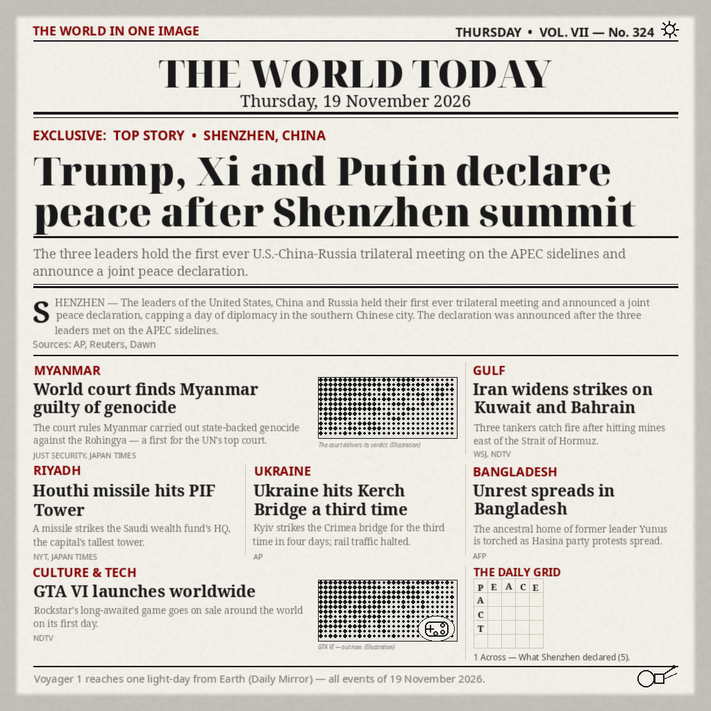
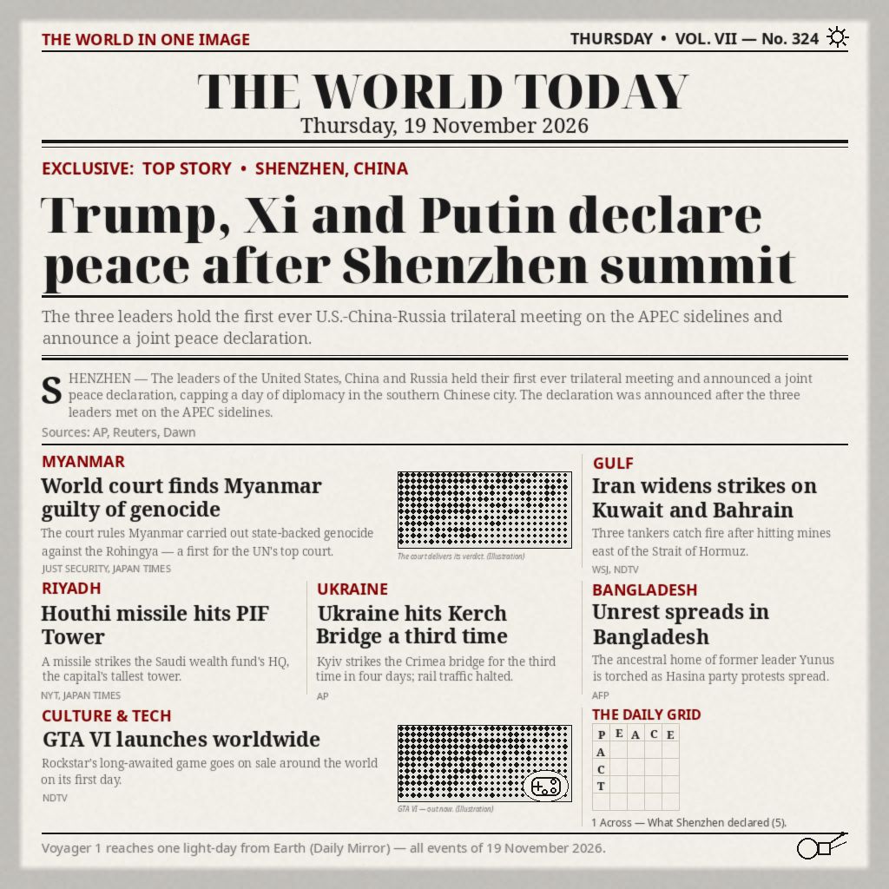
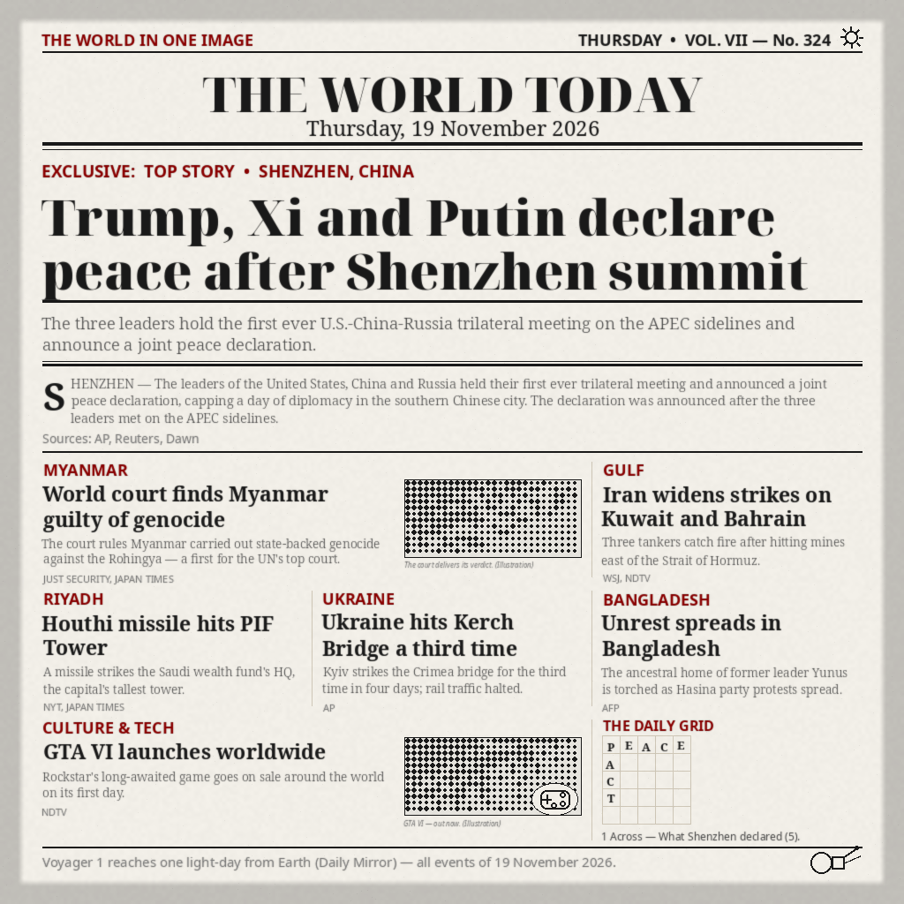

[](https://make.fun/competitions/news-image-20261119)
[](https://make.fun/competitions/news-image-20261119)
[](https://make.fun/competitions/news-image-20261119)

# The World Today — 19 November 2026

A newspaper front page that sums up the world's news of Thursday,
19 November 2026, in one 1024×1024 image (`entry.png`).

Made for the [news-image-20261119 bounty](https://make.fun/bounty/news-image-20261119)
on [make.fun](https://make.fun) — one image, the whole day.



## The day's stories

- **Lead — Shenzhen:** Trump, Xi and Putin declare peace after the first
  ever U.S.-China-Russia trilateral summit (AP, Reuters, Dawn).
- **Myanmar:** the International Court of Justice finds Myanmar guilty of
  state-backed genocide against the Rohingya, a first for the UN's top
  court (Just Security, Japan Times).
- **Gulf:** Iran widens strikes on Kuwait and Bahrain; three tankers catch
  fire after hitting mines east of the Strait of Hormuz (WSJ, NDTV).
- **Riyadh:** a Houthi missile hits the PIF Tower, the Saudi sovereign
  wealth fund's headquarters (NYT, Japan Times).
- **Ukraine:** Kyiv hits the Kerch Bridge a third time in four days; rail
  traffic halted (AP).
- **Bangladesh:** unrest spreads as the ancestral home of former leader
  Yunus is torched (AFP).
- **Culture & Tech:** GTA VI launches worldwide (NDTV). Also: Voyager 1
  reaches one light-day from Earth (Daily Mirror).

## Run it

```sh
python3 draw_image.py entry.png 19   # redraw the front page (seed 19)
mkdir -p out && MAKEFUN_OUTPUT_DIR=out node main.ts
# writes out/entry.png (1024x1024 PNG, deterministic bytes)
```

`main.ts` (Node 22, standard library only) copies the pre-drawn
`entry.png` to the output directory. The image itself is drawn by
`draw_image.py` (Pillow, in this repo): banner lead headline, halftone
photo placeholders, line-art icons, mini crossword, old-paper texture
with a vignette. Every fact was checked against live reporting on
19 November 2026. The script is deterministic — same seed, same bytes;
running it three times produces an identical sha256.

## Re-skin it for another day

All copy lives in the `NEWS` dict at the top of `draw_image.py` —
replace the seven stories and the page re-lays itself out (every block
is measured first; asserts guard overflow):

```python
NEWS = {
    "lead": {
        "kicker": "EXCLUSIVE:  TOP STORY  \u2022  SHENZHEN, CHINA",
        "headline": "Trump, Xi and Putin declare peace after Shenzhen summit",
        "deck": "The three leaders hold the first ever U.S.-China-Russia "
                "trilateral meeting on the APEC sidelines and announce a "
                "joint peace declaration.",
        "body": "SHENZHEN \u2014 The leaders of the United States, China "
                "and Russia held their first ever trilateral meeting ...",
        "sources": "Sources: AP, Reuters, Dawn",
    },
    "stories": [
        # (kicker, headline, body, sources) x 6 — first spans two columns,
        # last spans two columns beside the mini crossword
        ("MYANMAR", "World court finds Myanmar guilty of genocide",
         "The court rules Myanmar carried out state-backed genocide ...",
         "Just Security, Japan Times"),
        # ... Gulf, Riyadh, Ukraine, Bangladesh, Culture & Tech
    ],
    "footer": "Voyager 1 reaches one light-day from Earth (Daily Mirror) "
              "\u2014 all events of 19 November 2026.",
}
```

Then redraw with any seed:

```sh
python3 draw_image.py entry.png 42
```

## Variants (different random seeds)

The seed only moves the letterpress jitter, the halftone dots and the
paper grain — the layout and the words never change.

| seed 7 | seed 42 | seed 2026 |
|---|---|---|
|  |  |  |

## Fonts

All open-licensed (SIL OFL), no download needed on most Linux systems —
the script uses the system copies. To get them elsewhere:

- **Noto Serif Display Black** (banner + lead headline) —
  [Google Fonts](https://fonts.google.com/noto/specimen/Noto+Serif+Display)
- **Noto Serif / Noto Serif Light** (body, deck, drop cap) —
  [Google Fonts](https://fonts.google.com/noto/specimen/Noto+Serif)
- **Noto Sans** (kickers, captions, footer) —
  [Google Fonts](https://fonts.google.com/noto/specimen/Noto+Sans)

## Layout notes

- Lead headline breaks the grid: full-width, 56px extra-bold, with an
  `EXCLUSIVE:` kicker, a deck, a 3px rule, and a 3-line drop cap.
- Type is layered: serif-black headlines, light-serif body, sans
  captions; a 1–2px seeded jitter + 0.5px blur + 5% ink speckle
  imitates ink bleed on newsprint.
- Paper is old-paper `#F4F1EA` with fibre grain (Multiply 15%) and a
  20px vignette; column rules are 1px `#D0C8B8`.
